
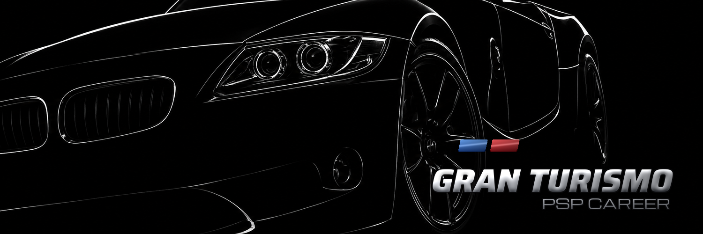

# Gran Turismo PSP Career 1.1

Gran Turismo PSP came out in 2009 with more than 800 cars and no career mode. Gran Turismo PSP Career is a free fan patch that adds one inside the game. It also brings back five tracks that were cut from the game, and adds 32 cars.

[**Download the patch**](https://github.com/Memetrix/gran-turismo-psp-career/releases/latest) · [**Install guide**](https://memetrix.github.io/gran-turismo-psp-career/)

[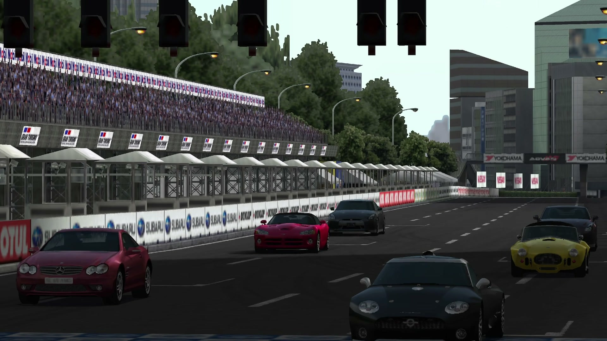](https://youtu.be/L62twE_V2KU)

Already played 1.0? What's new in 1.1

31 cars from GT1 to GT5, grids of up to eight cars, the five cut tracks in Single Race and Time Trial, adjustable gearboxes, LSD, brake balance, factory repaints, HUD editing and analog pedals. Career saves from 1.0 are supported; back up yours before updating.

## Career

- **289 events in nine halls**, from Beginner to Endurance. 125 are the classic Gran Turismo 4 events, from the Sunday Cup to the Gran Turismo World Championship. The other 164 are new.
- **74 championships** with the same rivals all season.
- **18 endurance races** up to 24 hours, saved in segments.
- **Prize cars from 262 events.**
- **Rally, dirt and snow** events.
- **Licences** as in GT4, earned in GT PSP's own Driving Challenge.
- **Every dealer is open every day**, and you can sell your cars.

## Five cut tracks

Complex String, Smokey Mountain, Tahiti Dirt, Rome and Hong Kong were cut from GT PSP. You can race them in the career, Single Race and Time Trial, and they run on a real PSP.

## 32 cars

31 cars from other Gran Turismo games. They are at the dealers, and each one is the prize of a career event:

- **Aston Martin** DB7 Vantage Coupe '00, DB9 '03, V8 Vantage '99, V12 Vanquish '04 (GT4)
- **Audi** Auto Union V16 Type C Streamline '37 (GT4)
- **Autobianchi** A112 Abarth '79 (GT4)
- **Caterham** Seven Fireblade '02 (GT4)
- **Chrysler** Prowler '02 (GT4)
- **Daihatsu** Midget '63 (GT4)
- **Dodge** Concept Car '97 (GT1)
- **Ford** GT40 Road Car '66 (GT3), GT90 '95 (GT2), Model T Tourer '15 (GT4)
- **Holden** Commodore SS '04, Monaro CV8 '04 (GT4)
- **Hyundai** Accent Rally Car '01 (GT4)
- **Jaguar** XFR '10 (GT5)
- **Jay Leno** Tank Car '03 (GT4)
- **Lamborghini** NOMAD Diablo GT-1 '00 (GT5)
- **Mazda** Axela 23S '03 (GT5)
- **Mercedes-Benz** Benz Patent Motor Wagen 1886, Daimler Motor Carriage 1886 (GT4)
- **MG** MGF '97, TF160 '03 (GT4)
- **Mitsubishi** Lancer Evolution VII Rally Car Prototype '01 (GT3)
- **Nike** One 2022 (GT4)
- **Polyphony Digital** F686/M (GT3)
- **Renault** Espace F1 '95 (GT2)
- **Toyota** GT-ONE Road Car '99 (GT3), Motor Triathlon Race Car '04 (GT4)
- **Vector** M12 '97 (GT2), at the Lamborghini dealer

And the **Ferrari 458 Italia**, which Polyphony planned for GT PSP and cut. Its data and engine sound come from Gran Turismo 5. It is at the Ferrari dealer and is the prize for Dream Machines.

## Racing

- **Up to eight cars on the grid**, in the career and in Arcade. The PSP-1000 races four.
- **Race HUD** presets and editor.
- **Analog throttle and brake** on the right stick.
- **Widescreen** aspect ratio in Options → Display.
- **Burnout mode.**

## Tuning

Parts use GT4 (USA) prices:

- Engine upgrades (turbo, NA tune, supercharger and more) and weight reduction
- Gearboxes with the final drive and every ratio
- LSD and brake balance
- Tyres for tarmac, dirt and snow
- Suspension kits
- Repaint in the car's factory colours

## In the game

| Career | Eight-car grids |
| --- | --- |
| 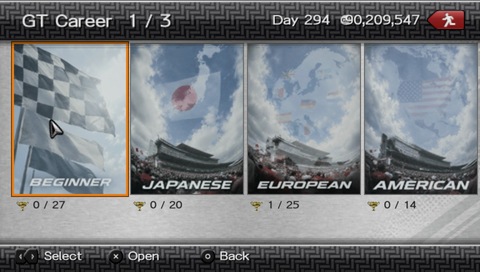 |  |

| Gearboxes | Suspension |
| --- | --- |
| 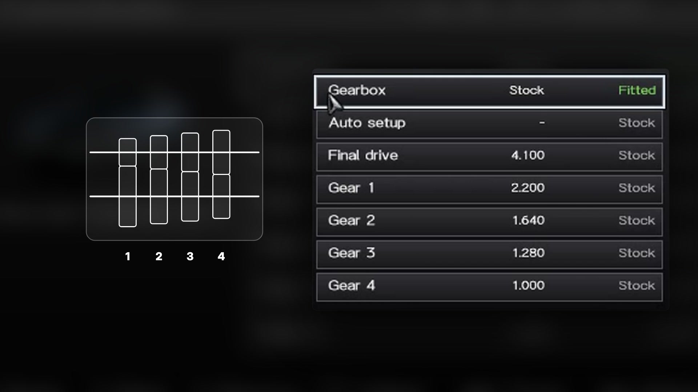 | 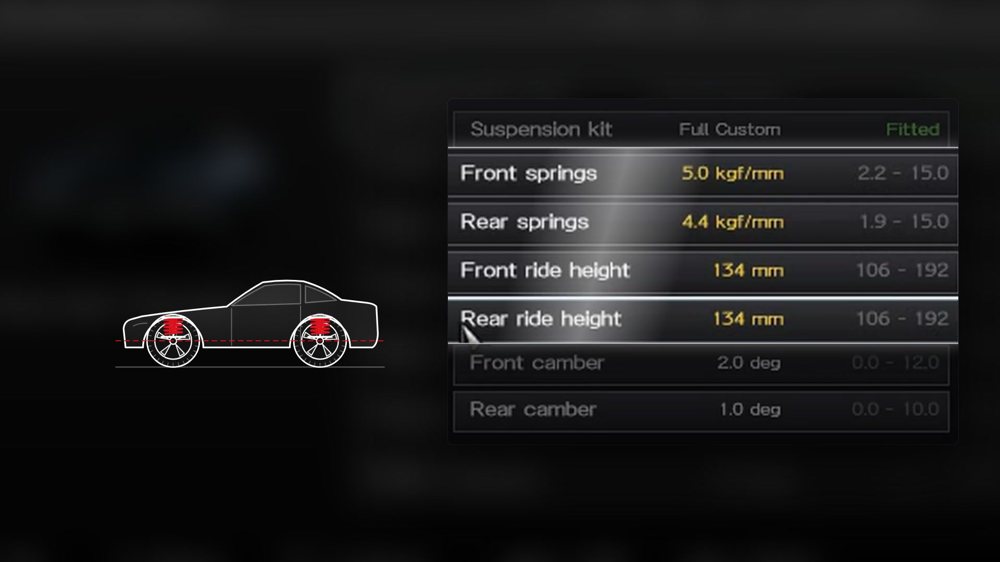 |

| Factory colours | HUD editor |
| --- | --- |
| 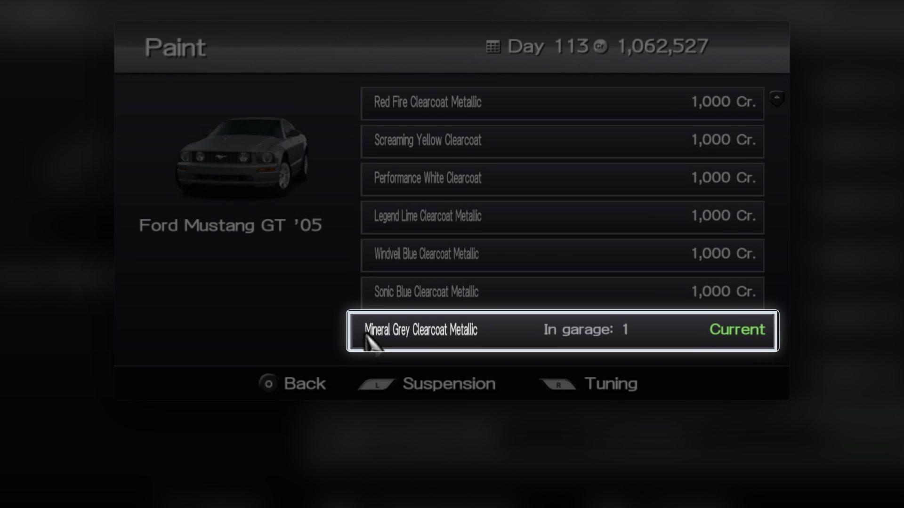 | 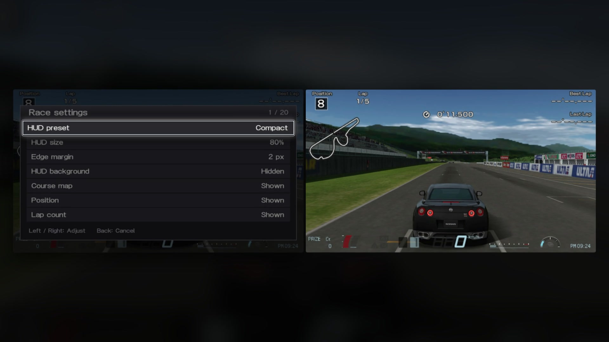 |

| Ferrari 458 Italia | Jay Leno's Tank Car |
| --- | --- |
| 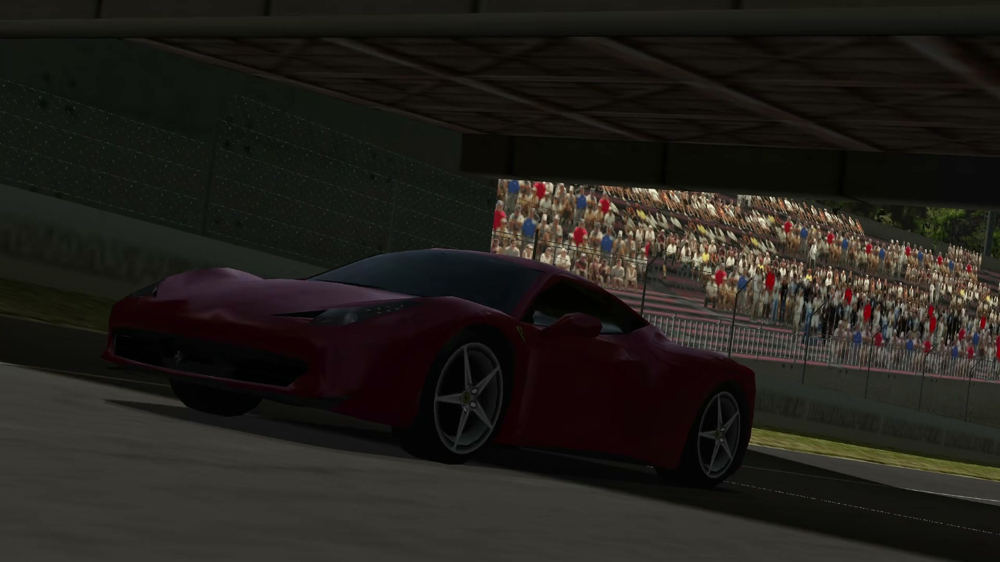 | 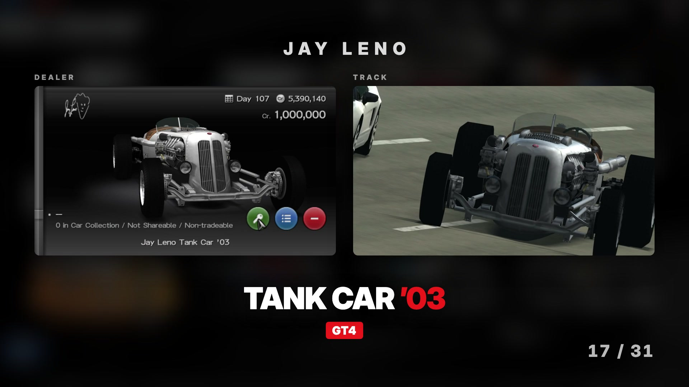 |

| Hong Kong | Snow rally |
| --- | --- |
| 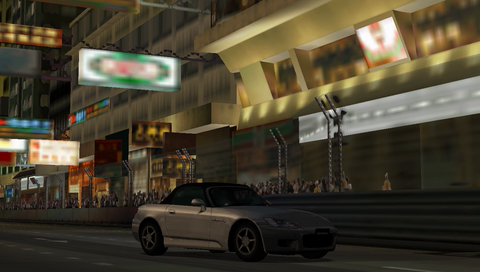 | 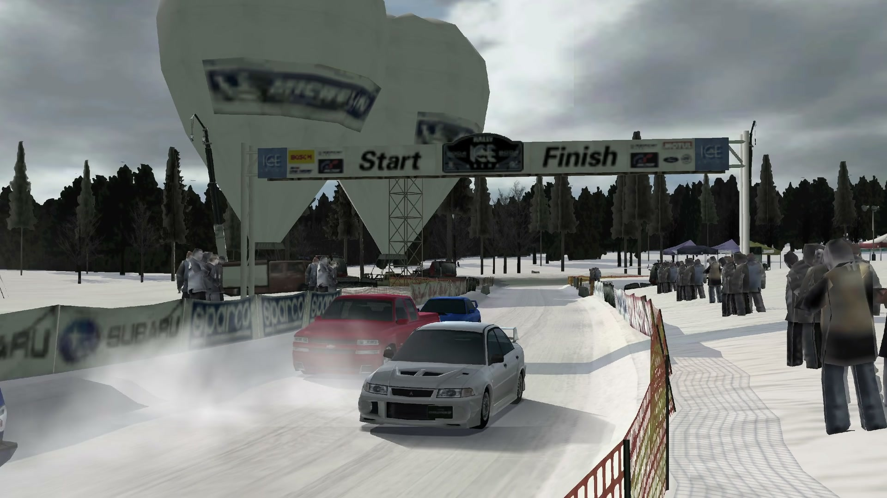 |

## Installing

You need your own unmodified Gran Turismo PSP ISO, USA version 1.00 or 2.00. One patch, `Gran-Turismo-PSP-Career-v1.1.xdelta` from the [1.1 release page](https://github.com/Memetrix/gran-turismo-psp-career/releases/latest), works with all three known USA dumps of the game. Apply it to your ISO with Delta Patcher on Windows or macOS, or UniPatcher on Android; the install guide has the steps. The patched game runs on a PSP with custom firmware and in PPSSPP. The European version is not supported.

The career has its own save and copies your garage and credits from your normal save, which stays untouched.

Install guide: https://memetrix.github.io/gran-turismo-psp-career/

| File | Size | CRC32 | SHA-256 |
| --- | --- | --- | --- |
| Gran-Turismo-PSP-Career-v1.1.xdelta | 39,563,844 bytes | `EBE92C20` | `69d45a2436f453b76857a910de21f5811df34955dc4caa389ec149affef42a49` |
| Patched ISO | 1,137,475,584 bytes | `A034807E` | `ae3d5268a3cc8777ba45e9bf00e3f3870a4cba0c1d5ee6f92ad7682cf4a95213` |

The patch accepts these USA ISOs (CRC32): `9613AC93` (UMD v1.00), `1EADB6B4` (UMD v2.00), `71DCC467` (v2.00). All three give the same patched ISO.

## Known issues

- The cut tracks have small graphical glitches.

Bug reports: https://github.com/Memetrix/gran-turismo-psp-career/issues, with your console or PPSSPP version, the event and round, and what happened. Please don't post or ask for ISOs.

Source (GPL-3.0) is attached to the [release](https://github.com/Memetrix/gran-turismo-psp-career/releases/latest); credits and licences are in [NOTICE.md](NOTICE.md). Step-by-step install: [INSTALL.md](INSTALL.md).

*Gran Turismo is a trademark of Sony Interactive Entertainment. This is a fan project, not affiliated with or endorsed by Sony Interactive Entertainment or Polyphony Digital. The download is a patch, not a game ISO; you need your own copy of the game.*
