
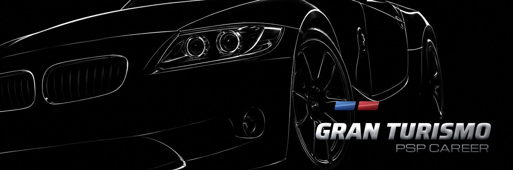

# Gran Turismo PSP Career 1.1.1

Gran Turismo PSP came out in 2009 with more than 800 cars and no career mode. Gran Turismo PSP Career is a free fan patch that adds one inside the game. It also brings back five tracks that were cut from the game, and adds 32 cars.

[**Download the patch**](https://github.com/Memetrix/gran-turismo-psp-career/releases/tag/v1.1.1) · [**Install guide**](https://memetrix.github.io/gran-turismo-psp-career/)

[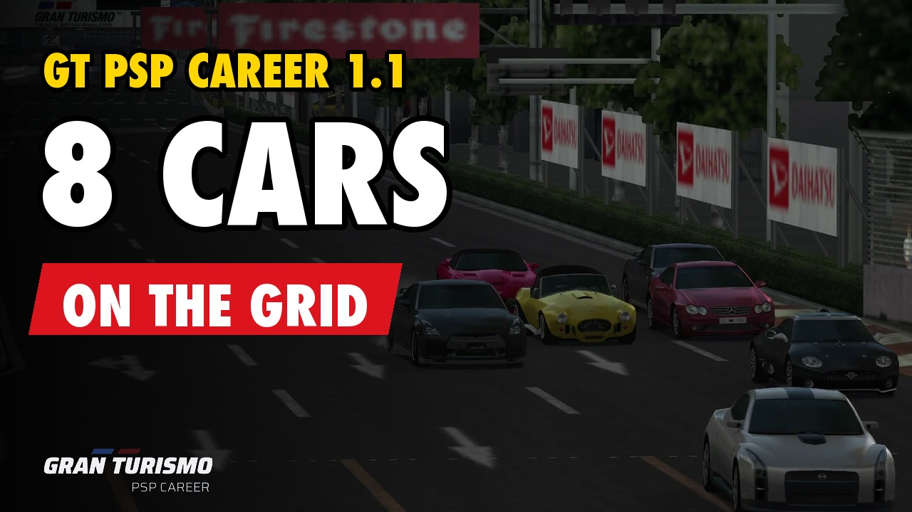](https://youtu.be/L62twE_V2KU)

Updating from 1.1? What's new in 1.1.1

1.1.1 is a bug-fix update. Career saves from 1.1 load as they are; back up yours before updating.

**Grids**
- Extended Grid offers 4, 5, 6 or 8 cars, in the career and in Arcade. Fewer cars can help the frame rate on a PSP.
- When the game can only race four cars, the greyed Extended Grid row says why.
- Arcade no longer stays at four cars after a session that started without the extra memory (the "Arcade 4, Career 8" report). Saves from 1.1 that stored this are corrected once on the first load.
- Cars 5 to 8 start on the track on every course. Città di Aria keeps four cars, because its grid has no room for more.
- Every car of an eight-car race keeps its engine sound and throws dust on dirt.
- Positions 5th to 8th use the same digits as 1st to 4th, in the race and in the replay.
- Ad-hoc races with eight-car grids: guests can drive again.

**Career and Arcade**
- Car Options no longer freezes a PSP after a paid finish (#52, #62), and Cancel no longer keeps memory (#23).
- SELECT: Use in Arcade takes a career car with its parts to Arcade, with its tuned engine sound (#64, #65, #68). Picking a car in the career garage no longer changes your Arcade car.
- The career keeps its own car after a visit to Arcade.
- More stock cars sell gearbox kits (#60), and the Dodge Concept Car, GT90, Vector M12, Espace F1, Jaguar XFR, Mazda Axela and Diablo GT-1 sell engine parts.
- Tyres under an event's ceiling: your best owned grade under it, otherwise the rivals' grade for free.
- The 3000GT SL enters 4WD events, as the PSP drives it. Le Mans Legends accepts the Chaparral 2D.
- Hide Prize Cars keeps a repeatable prize shown after its first win.
- The four restored GT3 courses and Gymkhana show their own logos in the career.
- Rome, Complex String, Smokey Mountain and Tahiti Dirt are lit like the stock courses.
- Three-wheelers (Daihatsu Midget, Benz Patent Motor Wagen) no longer tip over.
- Widescreen setting is kept on Android PPSSPP (#49).

**European version**
- The European disc (UCES01245, v2.00) is supported, in all eight of its languages, with its own patch.
- It reads your USA career save the first time it starts with no save of its own. On a PSP, the GT Career Save Converter attached to the [release](https://github.com/Memetrix/gran-turismo-psp-career/releases/tag/v1.1.1) copies saves either way.

Already played 1.0? What's new in 1.1

31 cars from GT1 to GT5, grids of up to eight cars, the five cut tracks in Single Race and Time Trial, adjustable gearboxes, LSD, brake balance, factory repaints, HUD editing and analog pedals. Career saves from 1.0 are supported; back up yours before updating.

## Career

- **289 events in nine halls**, from Beginner to Endurance. 125 are the classic Gran Turismo 4 events, from the Sunday Cup to the Gran Turismo World Championship. The other 164 are new.
- **74 championships** with the same rivals all season.
- **18 endurance races** up to 24 hours, saved in segments.
- **Prize cars from 262 events.**
- **Rally, dirt and snow** events.
- **Licences** as in GT4, earned in GT PSP's own Driving Challenge.
- **Every dealer is open every day**, and you can sell your cars.

## Tuning

Parts use GT4 (USA) prices:

- Engine upgrades (turbo, NA tune, supercharger and more) and weight reduction
- Gearboxes with the final drive and every ratio
- LSD and brake balance
- Tyres for tarmac, dirt and snow
- Suspension kits
- Repaint in the car's factory colours

## Five cut tracks

Complex String, Smokey Mountain, Tahiti Dirt, Rome and Hong Kong were cut from GT PSP. You can race them in the career, Single Race and Time Trial, and they run on a real PSP.

## 32 cars

31 cars from other Gran Turismo games. They are at the dealers, and each one is the prize of a career event:

- **Aston Martin** DB7 Vantage Coupe '00, DB9 '03, V8 Vantage '99, V12 Vanquish '04 (GT4)
- **Audi** Auto Union V16 Type C Streamline '37 (GT4)
- **Autobianchi** A112 Abarth '79 (GT4)
- **Caterham** Seven Fireblade '02 (GT4)
- **Chrysler** Prowler '02 (GT4)
- **Daihatsu** Midget '63 (GT4)
- **Dodge** Concept Car '97 (GT1)
- **Ford** GT40 Road Car '66 (GT3), GT90 '95 (GT2), Model T Tourer '15 (GT4)
- **Holden** Commodore SS '04, Monaro CV8 '04 (GT4)
- **Hyundai** Accent Rally Car '01 (GT4)
- **Jaguar** XFR '10 (GT5)
- **Jay Leno** Tank Car '03 (GT4)
- **Lamborghini** NOMAD Diablo GT-1 '00 (GT5)
- **Mazda** Axela 23S '03 (GT5)
- **Mercedes-Benz** Benz Patent Motor Wagen 1886, Daimler Motor Carriage 1886 (GT4)
- **MG** MGF '97, TF160 '03 (GT4)
- **Mitsubishi** Lancer Evolution VII Rally Car Prototype '01 (GT3)
- **Nike** One 2022 (GT4)
- **Polyphony Digital** F686/M (GT3)
- **Renault** Espace F1 '95 (GT2)
- **Toyota** GT-ONE Road Car '99 (GT3), Motor Triathlon Race Car '04 (GT4)
- **Vector** M12 '97 (GT2), at the Lamborghini dealer

And the **Ferrari 458 Italia**, which Polyphony planned for GT PSP and cut. Its data and engine sound come from Gran Turismo 5. It is at the Ferrari dealer and is the prize for Dream Machines.

## Racing

- **Up to eight cars on the grid**, in the career and in Arcade. The PSP-1000 races four.
- **Race HUD** presets and editor.
- **Analog throttle and brake** on the right stick.
- **Widescreen** aspect ratio in Options → Display.
- **Burnout mode.**

## In the game

| Career | Eight-car grids |
| --- | --- |
| 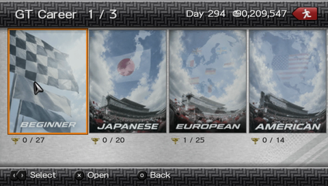 | 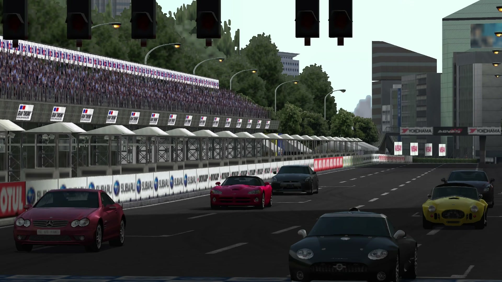 |

| Gearboxes | Suspension |
| --- | --- |
| 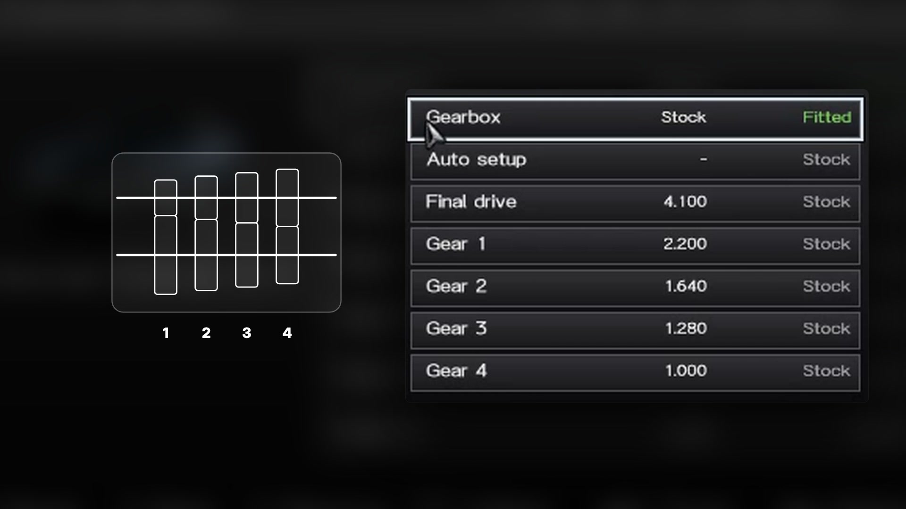 | 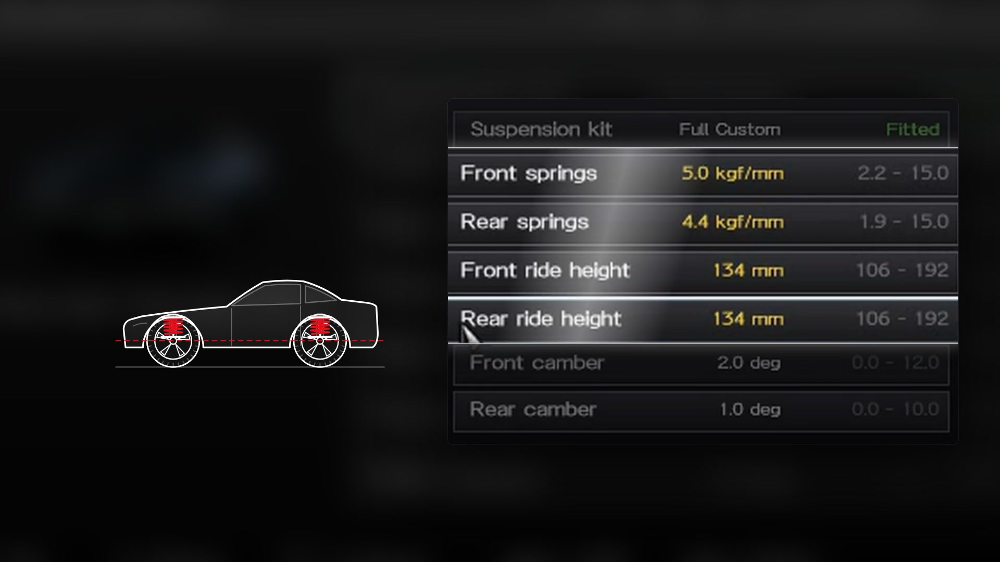 |

| Factory colours | HUD editor |
| --- | --- |
| 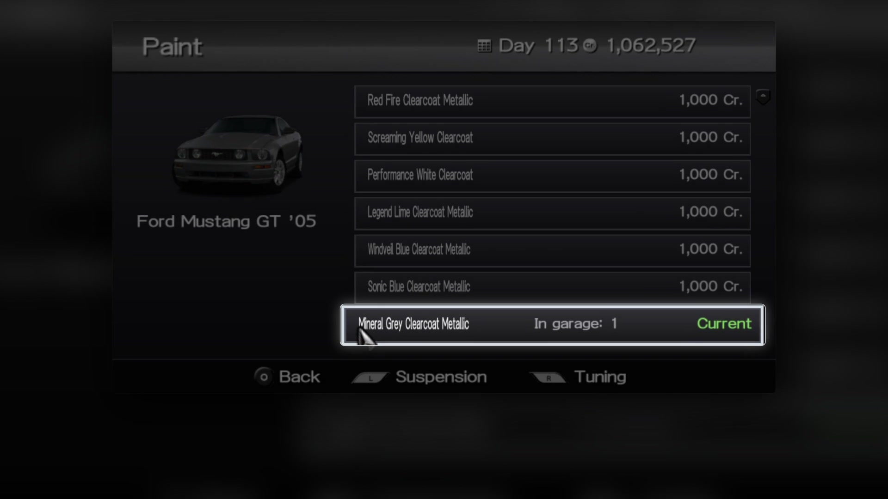 | 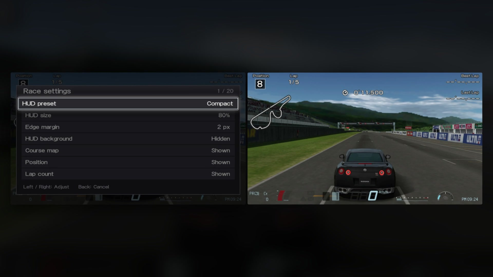 |

| Ferrari 458 Italia | Jay Leno's Tank Car |
| --- | --- |
| 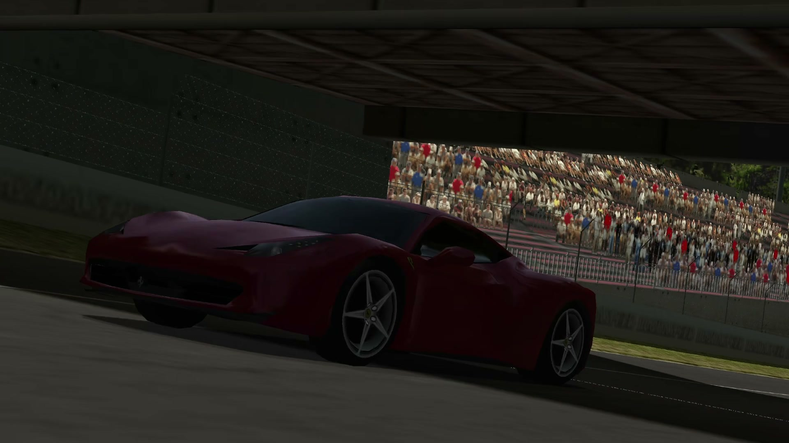 | 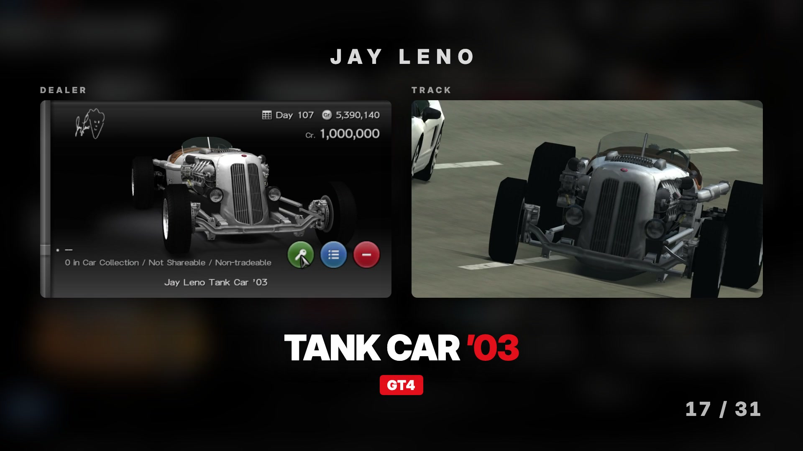 |

| Hong Kong | Snow rally |
| --- | --- |
| 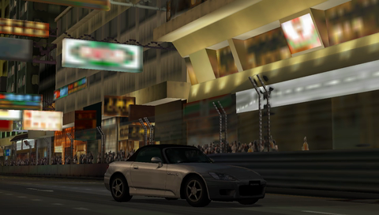 | 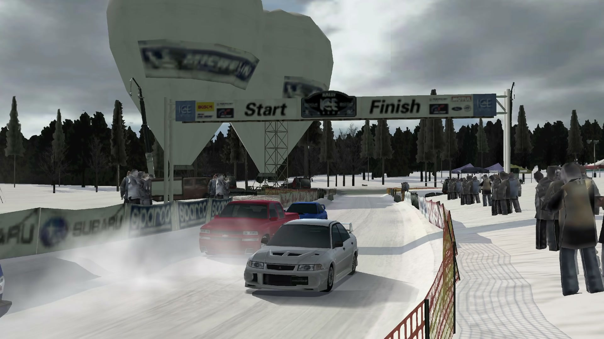 |

## Installing

You need your own unmodified Gran Turismo PSP ISO: the USA version 1.00 or 2.00, or the European version 2.00. Open the [browser installer](https://memetrix.github.io/gran-turismo-psp-career/), choose your ISO and save the patched game. It works on computers and Android, and your ISO is never uploaded.

For a USA ISO take `Gran-Turismo-PSP-Career-v1.1.1.xdelta`. It works with all three known USA dumps of the game.

For a European ISO (UCES01245) take `Gran-Turismo-PSP-Career-v1.1.1-Europe.xdelta`. The career is translated into the disc's eight languages: English, French, German, Italian, Spanish, Dutch, Portuguese and Russian.

Manual installation with Delta Patcher or UniPatcher is covered in [INSTALL.md](INSTALL.md). The patched game runs on a PSP with custom firmware and in PPSSPP.

The career has its own save and copies your garage and credits from your normal save, which stays untouched. Career saves from 1.1 load in 1.1.1; back up yours before updating.

Install guide: https://memetrix.github.io/gran-turismo-psp-career/

| File | Size | CRC32 | SHA-256 |
| --- | --- | --- | --- |
| Gran-Turismo-PSP-Career-v1.1.1.xdelta | 40,328,602 bytes | `39052CC0` | `6b96ababeab8e693e024f796c72b9e240124f361f9d902df67fc48c941e28513` |
| Patched ISO (USA) | 1,137,475,584 bytes | `709DCC77` | `f1dddd11c0f8045732b3e143ba63f530779d06f796c525d2629a9d5d3cc23246` |
| Gran-Turismo-PSP-Career-v1.1.1-Europe.xdelta | 36,163,033 bytes | `6CF100FF` | `8173ff20fb6c05a4ffc57103a0658cf2e06ebc6daf52baf37ffd850ad18bd2d7` |
| Patched ISO (Europe) | 1,222,475,776 bytes | `DE8DDC32` | `63c8fd320acd0b2e367012eb18bba4e55fbd5825dfb35f2ef39977a819d6e38f` |

The USA patch accepts these ISOs (CRC32): `9613AC93` (UMD v1.00), `1EADB6B4` (UMD v2.00), `71DCC467` (v2.00). All three give the same patched ISO. The European patch accepts `DA79C7C1` (Europe UMD v2.00).

## Moving your save from the USA version to the European one

The two versions keep their saves in different folders, and a PSP does not accept a folder that was only renamed.

In PPSSPP and on a PSP, start the European version while it has no save of its own. It finds your USA career save, tells you it has copied it, and saves to its own slot from then on. Your USA save is not changed.

On a PSP you can also copy a save in either direction with GT Career Save Converter. Unzip `GT-Career-Save-Converter.zip` from the [release page](https://github.com/Memetrix/gran-turismo-psp-career/releases/tag/v1.1.1), copy the `GTCSAVE` folder to `PSP/GAME` on the Memory Stick and run it from the Game menu. It asks before replacing a save that is already there.

## FAQ

**I chose 8 cars but I race 4 (or the Extended Grid row is greyed).**
Eight cars need the extra memory of a PSP-2000 or later. The PSP-1000 races four, and Città di Aria races four on every console.
- PPSSPP: Settings → System → PSP settings → PSP model must be PSP-2000/3000. Restart the game after changing it.
- PSP on custom firmware: on its first start the game asks ARK for the extra memory and tells you to restart. If the row stays greyed, open the CFW settings, change High Memory from Auto to Forced and start the game again.

**PS Vita / Adrenaline freezes, or the second eight-car race does not load.**
A player traced this to the "Suspend threads" option of Adrenaline Bubble Booter (Booter tab): turn it off. Plain Adrenaline has no such option.

**The game runs slowly with eight cars on my PSP.**
Choose 5 or 6 cars in Options → Extended Grid, or set the CPU clock above 333 MHz in your custom firmware settings.

## Known issues

- On a PSP, the frame rate drops on Rome and Complex String. For full speed, set the CPU clock above 333 MHz in your custom firmware settings.
- The cut tracks have small graphical glitches.

Bug reports: https://github.com/Memetrix/gran-turismo-psp-career/issues, with your console or PPSSPP version, the event and round, and what happened. Please don't post or ask for ISOs.

Source (GPL-3.0) is attached to the [release](https://github.com/Memetrix/gran-turismo-psp-career/releases/tag/v1.1.1); credits and licences are in [NOTICE.md](NOTICE.md). Step-by-step install: [INSTALL.md](INSTALL.md).

*Gran Turismo is a trademark of Sony Interactive Entertainment. This is a fan project, not affiliated with or endorsed by Sony Interactive Entertainment or Polyphony Digital. The download is a patch, not a game ISO; you need your own copy of the game.*
